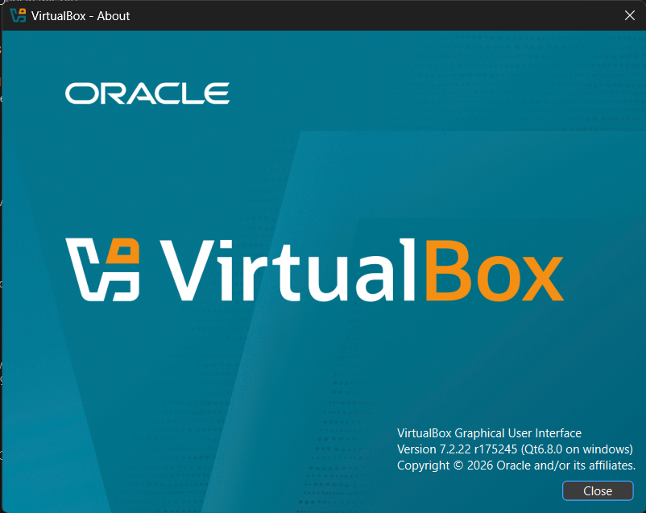
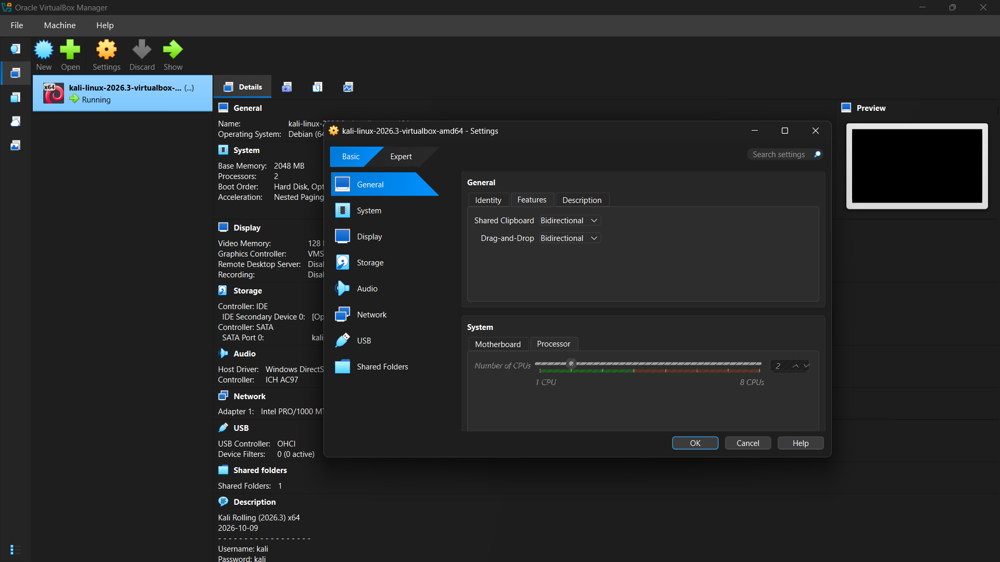
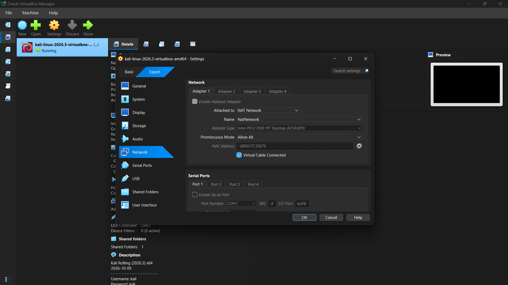

# NETWORKWALKS-FELICIA-B084-WK1-PM1-CYBERSECURITY-LAB-SETUP
# 🚀 Cybersecurity Lab Setup: VirtualBox & Kali Linux

**Program:** Cybersecurity Program at Networkwalks | **Author:** Felisia Hafenanye  

## 🔒 Overview
I built an isolated virtual cybersecurity lab on my computer using VirtualBox and Kali Linux equipped with shared folders, clipboard integration, and snapshots.

## 📸 Setup & Proof of Work
* **VM Setup:** Installed VirtualBox, created an isolated host-only network, and imported Kali Linux.
  
  
* **Configuration:** Configured RAM/CPU settings, network interfaces, and shared folders.
  
  
* **Verification:** Tested IP configuration (`ip a`) and verified connectivity via terminal and browser.
  

## 💡 Key Lesson
If the network interface doesn't pull an IP automatically after setup, manually restarting the network manager (`sudo systemctl restart NetworkManager`) resolves state mismatches.

Everything was completed in my own lab environment[cite: 1].

**Tags:** `@NETWORKWALKS` `@WAQAS KARIM CCIE` `#Networkwalks` `#Cybersecurity` `#KaliLinux`
